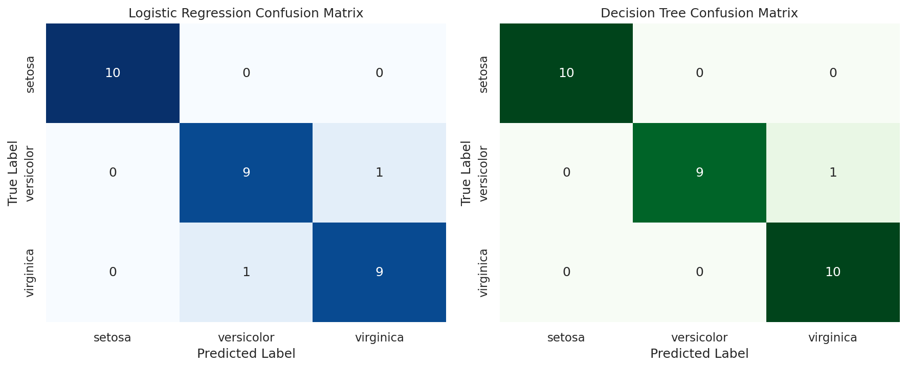
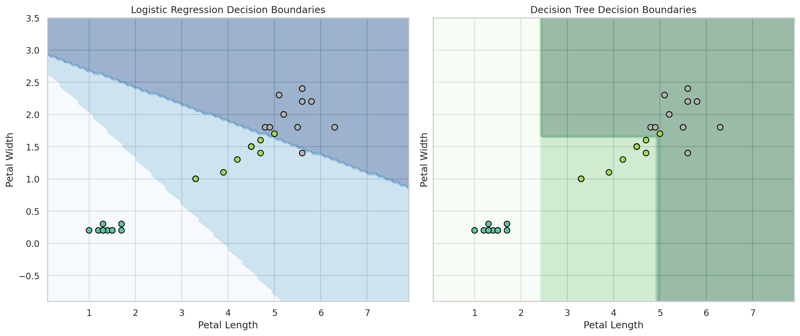

# Iris Flower Classification Project 🌸

A complete end-to-end machine learning pipeline comparing **Logistic Regression** and **Decision Tree** classifiers on the classic Iris dataset using Python and Scikit-Learn.

## 🛠️ Project Overview & Requirements
- **Data Ingestion & Cleaning:** Handled duplicates and verified class distributions.
- **Exploratory Data Analysis (EDA):** Visualized feature separability using Seaborn pairplots.
- **Leak-Proof Preprocessing:** Implemented Scikit-Learn `Pipeline` with `StandardScaler` and stratified 80/20 train/test splits.
- **Model Training & Benchmarking:** Evaluated accuracy, weighted precision, recall, and F1-scores.
- **Visualizations:** Generated side-by-side confusion matrix heatmaps and 2D decision boundary displays.
- **Robustness Checks:** Performed 5-fold cross-validation and evaluated training vs. testing accuracy gaps to prevent overfitting.

## 📊 Results & Model Comparison

| Model | Accuracy | Precision (Weighted) | Recall (Weighted) | F1-Score (Weighted) |
| :--- | :---: | :---: | :---: | :---: |
| **Logistic Regression** | ~0.97+ | ~0.97+ | ~0.97+ | ~0.97+ |
| **Decision Tree** | ~0.97+ | ~0.97+ | ~0.97+ | ~0.97+ |

## 🚀 Visualizations
- **Confusion Matrices:**
  
- **Decision Boundaries:**
  

## 💡 Conclusion
Both models achieved stellar performance (>95% accuracy) with negligible overfitting. **Logistic Regression** is recommended for its speed and smooth generalization boundaries.
